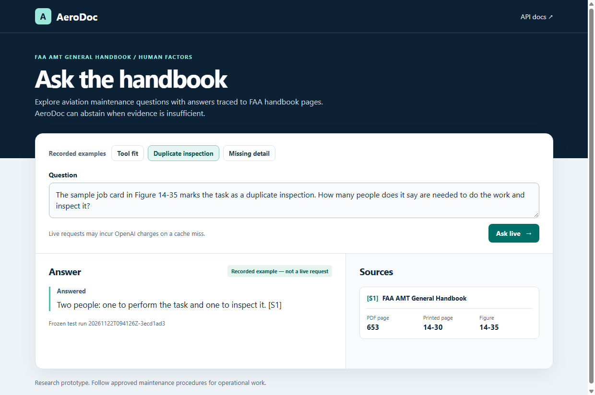
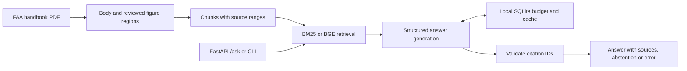

# AeroDoc v0.1

AeroDoc is a retrieval-augmented generation (RAG) prototype that answers
aviation maintenance questions from selected source text with page citations.
It can abstain when the retrieved passages provide insufficient evidence.



*Recorded example T05 from the frozen test run. The screenshot shows the
saved answer and its source metadata.*

[](https://github.com/YetkinMM/AeroDoc/actions/workflows/ci.yaml)

## What v0.1 covers

- **Corpus.** Chapter 14, Human Factors, of the FAA Aviation Maintenance
  Technician General Handbook. The corpus covers 32 pages (PDF 624–655,
  printed 14-1–14-32) and contains 111 chunks (75 body, 36 figure). The
  extraction uses 37 reviewed figure boundaries. One region's text stays
  in the body to avoid duplicating it. Chunks retain PDF and printed page
  labels and traceable source block and character ranges.
- **Retrieval.** BM25 and BGE baselines search the same chunk text. The
  FastAPI answer service defaults to BM25 with five passages.
- **Answers.** OpenAI GPT-6 Luna returns a structured answer or abstention.
  Code validates citation IDs against the retrieved passages. The API
  distinguishes insufficient evidence, provider errors and budget limits.
  A local SQLite ledger tracks reservations and estimated costs and stores
  cached answers across restarts.
- **Packaging.** Docker Compose binds the FastAPI service to localhost.
  GitHub Actions runs the fixture and mock tests and builds the image.



## Quick start

Use Python 3.13 and Docker Desktop in Linux container mode. Run these
PowerShell commands from the repository root. A clean checkout needs the
[FAA handbook PDF](https://www.faa.gov/regulations_policies/handbooks_manuals/aviation/amtg_handbook.pdf)
saved as `data/raw/amtg_handbook.pdf`. Use the edition and SHA-256 in the
[source manifest](data/raw/manifest.json). The PDF, generated audit
artifacts, model weights and ledger are local files.

```powershell
py -3.13 -m venv .venv
.\.venv\Scripts\python.exe -m pip install -r requirements-chunking.lock.txt
.\.venv\Scripts\python.exe -B scripts/extract_corpus.py
.\.venv\Scripts\python.exe -B scripts/fetch_chunk_tokenizer.py
.\.venv\Scripts\python.exe -B scripts/build_chunks.py
.\.venv\Scripts\python.exe -B scripts/retrieval.py build --bm25-only
```

This creates `audit/chunking/chunks.jsonl` and the BM25 files
`audit/retrieval/index.json` and `audit/retrieval/bm25.json`. Compose mounts
the three files read-only. Allow time for chunking to scan the full PDF
for hyphenation evidence. If the files already exist and match the source and
configuration, reuse them. For BGE weights and the full index, follow the
[retrieval guide](docs/retrieval.md).

Follow the [Docker guide](docs/docker.md#temiz-checkout-hazırlığı) to reuse
`audit/answers/ledger.sqlite3`, or initialize it once for a genuinely new
installation. Then start the service and check that it has loaded BM25.

```powershell
docker compose --env-file .env.example up -d --build
Invoke-RestMethod http://127.0.0.1:8000/health
```

If the service is still starting, retry the health check after a few
seconds. The expected response is `{"status":"ok","retrieval":"bm25"}`. Swagger UI
is at `http://127.0.0.1:8000/docs`. Open the demo at
`http://127.0.0.1:8000/` to browse the recorded examples. Health checks and
BM25 searches do not need an API key. For live answers, pass `OPENAI_API_KEY` only at runtime
using the [Docker guide](docs/docker.md#başlatma-loglar-ve-durdurma).
A valid `POST /ask` request can incur OpenAI charges on a cache miss.
The [recorded demo](docs/demo.md) can be presented without new API calls.

```powershell
docker compose --env-file .env.example stop
```

## Recorded evaluation

**Development.** The development split contains eight answerable and two
unanswerable questions. At k=5, BM25 scored 100% on all three retrieval
metrics and BGE scored 87.50% page hit, 75.00% evidence recall and 75.00%
all-evidence hit. The development answer run recorded eight `answered`
and two `insufficient_evidence` responses.

**Frozen test set.** [test-v0.1](eval/test_questions.json) contains 18
answerable and six unanswerable questions. The retrieval metrics use the
18 answerable questions as their denominator.

- **Page hit** is the share of questions with at least one expected source
  page retrieved.
- **Evidence recall** is the mean, across questions, of the fraction of
  required evidence units covered by retrieved source text ranges.
- **All-evidence hit** is the share of questions with every required
  evidence unit covered.

| Retrieval | k | Page hit | Evidence recall | All-evidence hit |
| --- | ---: | ---: | ---: | ---: |
| BM25 | 1 | 88.89% | 67.59% | 61.11% |
| BM25 | 3 | 94.44% | 83.33% | 77.78% |
| BM25 | 5 | 100.00% | 94.44% | 94.44% |
| BGE | 1 | 72.22% | 56.48% | 50.00% |
| BGE | 3 | 88.89% | 75.00% | 72.22% |
| BGE | 5 | 94.44% | 88.89% | 88.89% |

The completed answer run used BM25 k=5 and answered 17 of 18 answerable
questions. Project owner Muhlis Yetkin reported on 2026-11-22 that all 17
generated answers were correct, sufficient and supported by their cited
sources after comparison with the reference answers and cited text.
Answerable T14 remained unanswered with `insufficient_evidence`. BM25
retrieved the right page (PDF 639, printed 14-16), and its top five chunks
missed the necessary sentence about feeling alert while fatigued. The
system abstained on all six unanswerable questions.

The project owner completed this human review after the recorded ChatGPT
`assistant_review`. For T05, he found direct support for the two-person
requirement and accepted the division of duties as a reasonable inference
from the duplicate inspection context.

The completed test run and its probe cost an estimated **USD 0.00553**
based on recorded usage. See the [evaluation summary](docs/test_evaluation_summary.md)
for details.

## Limitations and future work

The small, source-derived test set supports a comparison on this chapter.
Broader BM25 superiority and production reliability require separate
evidence. Figure answers use extracted text from bounded regions. General
visual understanding is outside the prototype's capabilities. Valid
citation IDs establish that a passage was retrieved. Semantic support
requires reviewing the passage against the claim.

AeroDoc is a research and portfolio prototype. Use approved maintenance
procedures for operational work.

Future work includes a local LLM, hybrid retrieval, a reranker,
fine-tuning, a broader corpus and an interface that highlights the cited
source. Develop changes on the development split and measure them on
newly held-out test data.

## Further reading

- [Figure-region extraction](docs/approved_region_extraction.md) and [chunking and provenance](docs/chunking.md)
- [Retrieval baselines](docs/retrieval.md) and [answer generation and accounting](docs/answers.md)
- [Docker and CI](docs/docker.md), [evaluation summary](docs/test_evaluation_summary.md) and [short demo](docs/demo.md)
