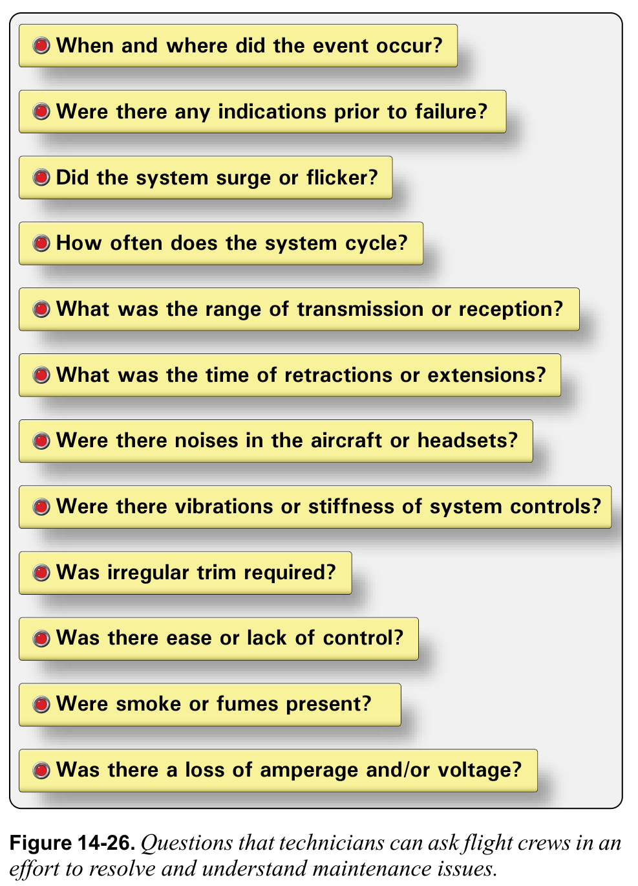
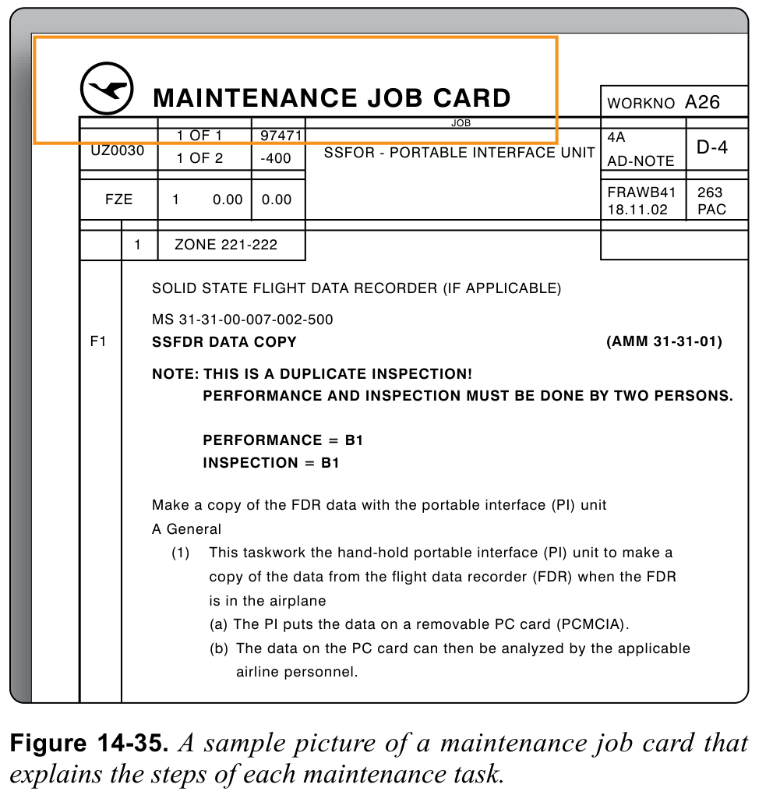
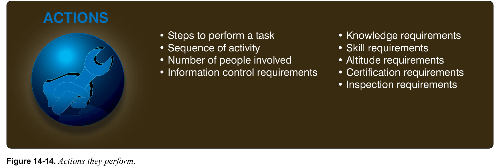
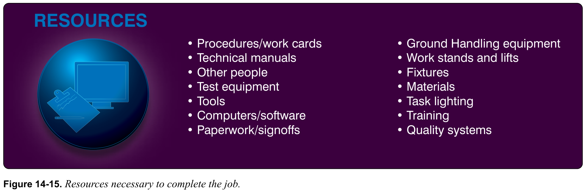

# AeroDoc test soruları inceleme taslağı

Corpus **v0.1** · FAA Aviation Maintenance Technician Handbook – General, Chapter 14 · PDF **624–655** · basılı **14-1–14-32**.

18 cevaplanabilir, 6 cevaplanamaz soru var. Cevaplanabilir 18 soru kaynak cümlesini kopyalamadan yazıldı. T02, T04 ve T06 ayrı pasajları birleştirir. T03, T05, T06 ve T07 doğrudan şekil metni kullanır. T12 tek pasajın iki sayfaya yayıldığı bir örnektir. Kullanıcı 22 Kasım 2026 tarihinde soru, referans cevap ve kanıt eşleşmelerini ve yokluk gerekçelerini kabul etti. Onayın kapsamı bu kayıtlarla sınırlı.

Alıntılar, yalnızca boşluklar ve satır sonları tek boşluğa dönüştürülerek kaynak PDF metninde doğrulandı. Şekil alıntıları ayrıca ilgili corpus şekil kaydında kontrol edildi. Cevaplanamayan sorularda anahtar ifade taraması, şekil metinleri dahil PDF 624–655 aralığının tamamını kapsadı. Taramadaki eşleşmeler, konuya yakın pasajların elle okunmasına yardımcı oldu.

## Cevaplanabilir sorular

| ID ve tür | Soru | Referans cevap | PDF / basılı sayfa ve birebir kanıt | İnceleme |
| --- | --- | --- | --- | --- |
| T01 · application | Why might a technician with a smaller build work more efficiently with a different set of tools? | Tools and equipment sized for the technician can make the same task more efficient. | PDF 627 / 14-4 — “someone who is smaller may be able to perform more efficiently with tools and equipment tailored to their size.” | user_approved D03 shares the work-environment topic. This item tests tool fit and uses a different passage. |
| T02 · multi_passage | What is MEDA trying to achieve when it investigates an error, and why might a high-profile event work against that aim? | MEDA investigates errors to understand root causes and prevent accidents. A high-profile event can make investigation harder because attention from senior management and regulators may intimidate the people involved. | PDF 633 / 14-10 — “The goal of using MEDA is to investigate errors, understand root causes, and prevent accidents, instead of simply placing blame on the maintenance personnel for the errors.” PDF 634 / 14-11 — “a highly visible event may not really be the best opportunity to investigate errors. Those involved in the process may be intimidated by the attention coming from upper management and various regulatory authorities.” | user_approved |
| T03 · figure_text | According to Figure 14-26, what should technicians ask flight crews about unusual movement or resistance in the system controls? | Whether the system controls vibrated or felt stiff. | PDF 647 / 14-24, Figure 14-26 — “Were there vibrations or stiffness of system controls?” | user_approved Check that the wording points to the control-feel prompt. The figure also contains a separate question about ease of control. |
| T04 · multi_passage | A technician takes over an unfinished job and is later interrupted. What two forms of handoff should they receive before starting, and where should they resume after the interruption? | They should receive both an oral and a written turnover. After the interruption, they should go back three steps from the point of distraction and resume there. | PDF 637 / 14-14 — “It is vital that work not be continued on a project without both oral and written communication between the technician who started the job and the technician continuing it.” PDF 639 / 14-16 — “A good practice is to go back three steps in the work procedure from when distraction occurred and resume the job from that point.” | user_approved Check that the answer distinguishes a handoff requirement from the handbook’s suggested restart practice. |
| T05 · figure_text | The sample job card in Figure 14-35 marks the task as a duplicate inspection. How many people does it say are needed to do the work and inspect it? | Two people are needed to perform and inspect the work. | PDF 653 / 14-30, Figure 14-35 — “PERFORMANCE AND INSPECTION MUST BE DONE BY TWO PERSONS.” | user_approved Check that the answer stays scoped to the sample card. |
| T06 · multi_passage_figure_text | What worker competencies does a job task analysis identify, and which requirements concerning certification and inspection appear under Actions in Figure 14-14? | The analysis identifies the knowledge, skills, and attitudes needed for each task. The figure lists certification requirements and inspection requirements. | PDF 633 / 14-10 — “Job task analysis (JTA) is the standard human factors approach to identify the knowledge, skills, and attitudes necessary to perform each task in a given job.” PDF 635 / 14-12, Figure 14-14 — “Certification requirements” PDF 635 / 14-12, Figure 14-14 — “Inspection requirements” | user_approved The question names certification and inspection explicitly and asks separately what the job task analysis identifies. |
| T07 · figure_text | Which resources in Figure 14-15 are listed for illuminating the task and for providing a raised work platform or lifting equipment? | Task lighting and work stands and lifts. | PDF 635 / 14-12, Figure 14-15 — “Task lighting” PDF 635 / 14-12, Figure 14-15 — “Work stands and lifts” | user_approved The question describes a raised work platform or lifting equipment and asks for the resource labels in Figure 14-15. |
| T08 · classification | In the SHEL model, which component covers a confusing checklist layout, and which covers a hard-to-reach aircraft component? | Software covers checklist layout. Hardware covers component accessibility. | PDF 635 / 14-12 — “Instead it includes a broader view of manual layout, checklist layout, symbology, language (both technical and nontechnical), and computer programs. Hardware includes such things as the location of components, the accessibility of components and tooling.” PDF 635 / 14-12 — “The term “software” is not referring to the common use of the term as applied to computer programs.” | user_approved |
| T09 · cause_effect | What can happen to the visibility of errors when a company relies on punishment to control behavior? | Errors can be driven underground and come to light later, often at a more critical moment. | PDF 631 / 14-8 — “This “crackdown” approach for behavior control is based upon fear and punishment, which creates a problem. Errors are driven into hiding, and then become apparent later, usually at a more critical time (“Murphy’s Law”).” | user_approved D02 also concerns error visibility. This item tests the effect of punitive management and uses a different passage. |
| T10 · concept | In a PEAR organizational environment with a strong safety culture, how does each person understand their own job in relation to safety? | Each person sees their role as contributing to the safety of the overall mission. | PDF 633 / 14-10 — “In a safe culture, each person understands their individual role is contributing to overall mission safety.” | user_approved |
| T11 · list_lookup | Which two common maintenance errors involve leaving tools or parts behind, or failing to remove a locking device? | Forgotten tools and parts, and failure to remove lock pins. | PDF 651 / 14-28 — “Forgotten tools and parts.” PDF 651 / 14-28 — “Failure to remove lock pins.” | user_approved Check that the two descriptions identify the intended list entries. |
| T12 · page_boundary | When unsure about an unfamiliar aircraft procedure, whom should a technician consult first, and whom should they contact if that source cannot help? | Consult a technician experienced on the aircraft first. Contact a manufacturer’s technical representative if no such technician is available or the technician is unfamiliar with the procedure. | PDF 637 / 14-14 — “When in doubt, a technician with experience” PDF 638 / 14-15 — “on the aircraft should be consulted. If one is not available, or the consulted technician is not familiar with the procedure, a manufacturer’s technical representative should be contacted.” | user_approved The evidence crosses a PDF page break within one paragraph. |
| T13 · recommended_response | Just before signing for a routine inspection item, what should a technician do to make sure the sign-off is warranted? | Read the item and confirm the work was performed before signing. | PDF 637 / 14-14 — “Prior to the pen touching the paper for a signature, the technician should read the item before signing and confirm it has been performed.” | user_approved |
| T14 · concept | Why is feeling alert an unreliable way to rule out fatigue during maintenance? | A fatigued technician can still feel wide awake and engaged in the task. | PDF 639 / 14-16 — “However, sometimes a fatigued person may feel wide awake and engaged in a task.” | user_approved |
| T15 · sequence | What sequence of AOG desks does the handbook describe for escalating a grounded-aircraft problem? | The operator’s internal AOG desk first, then the manufacturer’s, then competitors’ AOG desks. | PDF 643 / 14-20 — “Usually the problem is escalated through an internal AOG desk, then the manufacturer’s AOG desk, and finally competitors’ AOG desks.” | user_approved |
| T16 · recommended_response | If a needed troubleshooting detail is missing from the available manuals, what people or group does the handbook suggest asking? | Ask a supervisor, or contact a technical representative or technical publications department at the relevant aircraft manufacturer. | PDF 644 / 14-21 — “If the information is unavailable, personnel should ask a supervisor or speak with a technical representative or technical publications department at the appropriate aircraft manufacturer.” | user_approved |
| T17 · cause_effect | What makes someone new to a maintenance crew good at spotting unsafe habits but less able to change them right away? | Newcomers are better at spotting unsafe norms than established members, but their credibility depends on becoming accepted by the group. They can begin to change norms after building that credibility. | PDF 650 / 14-27 — “Newcomers are better able to identify these unsafe norms than long-standing members of the group. On the other hand, the newcomer’s credibility depends on their assimilation into the group.” PDF 650 / 14-27 — “as newcomers become assimilated into the group structure, they build credibility with others. Once this has been done, a relative newcomer may begin to institute change within the group.” | user_approved |
| T18 · cause_effect | How can coming to work sick reduce the energy an AMT has available for essential tasks? | Fighting the illness can take more of the body’s energy, leaving less for essential work. | PDF 648 / 14-25 — “trying to work when ill or not feeling well can force the body to use more energy fighting the illness, leaving less energy to perform vital tasks.” | user_approved |

## Cevaplanamayan sorular

| ID ve tür | Soru | Corpus kapsamında neden cevaplanamaz | İncelenen pasajlar ve PDF genelinde arama | İnceleme |
| --- | --- | --- | --- | --- |
| T19 · missing_identifier | What revision identifier appears on the MEDA results form described in the chapter? | The chapter describes what investigators record on the form, but provides no copy of the form or revision identifier for it. | PDF 633, 634 / 14-10, 14-11 — MEDA overview and investigation step; the step lists what the results form records. `\bMEDA\b` → 633, 634 `results form` → 634 `form number\|revision identifier\|revision number` → eşleşme yok | user_approved Confirm the nearest passages and the scope of the absence claim. |
| T20 · missing_retention_period | How long does the chapter say a maintenance organization must retain written shift-turnover records? | The chapter calls for written and oral turnover but gives no retention period for the written records. | PDF 636, 637, 638 / 14-13, 14-14, 14-15 — Communication and shift turnover guidance, including the written and oral turnover advice and the communication figure. PDF 640, 655 / 14-17, 14-32 ? Shift-change communication as a source of error and the Airbus incident turnover; neither discusses record retention. `shift change\|turnover\|handoff` → 637, 640, 655 `retain\|retention\|archiv` → eşleşme yok | user_approved Confirm the nearest passages and the scope of the absence claim. |
| T21 · missing_interval | What recurring calibration interval does the chapter specify for the electronic load cells in the aircraft-weighing example? | The chapter explains what happened when the correct load cells were unavailable and says to address out-of-calibration tools promptly. It gives no recurring calibration interval for those load cells. | PDF 641, 642, 643, 644, 645, 646 / 14-18, 14-19, 14-20, 14-21, 14-22, 14-23 — Lack of Resources text and mitigation figure, including the aircraft-weighing example and handling of out-of-calibration tools. `load cells?` → 643 `calibrat\w*` → 644 `calibration interval\|recalibrat\w*` → eşleşme yok | user_approved Confirm the nearest passages and the scope of the absence claim. D09 also asks for an absent technical detail. The equipment, detail and passages differ. |
| T22 · missing_dimension | What minimum opening width does the chapter give for the aircraft crawl space in its anthropometry example? | The example gives the technician’s height and weight, but gives no width or minimum opening size for the crawl space. | PDF 626, 627, 628 / 14-3, 14-4, 14-5 — Human factors disciplines, anthropometry example, and adjacent figure text. PDF 629, 630 / 14-6, 14-7 ? Historical anthropometry and figures; the clearance hit refers to ATC instructions. `anthropometr\w*\|crawl space` → 625, 627, 629, 630 `opening width\|minimum width\|clearance\|\bwidth\b` → 629 | user_approved Confirm the nearest passages and the scope of the absence claim. D03 mentions confined workspaces. This item asks for a missing opening dimension in a separate example. |
| T23 · missing_contact_detail | What direct phone number does the chapter provide for a competitor’s AOG desk? | The chapter describes when to escalate to competitors’ desks and how major carriers staff their desks. It supplies no direct number for a competitor’s AOG desk. | PDF 642, 643 / 14-19, 14-20 — AOG logistics and escalation PDF 653, 654 / 14-30, 14-31 — Human factors organizations, safety teams and resource listings. `\bAOG\b` → 642, 643 `phone\|telephone\|contact` → 633, 637, 638, 654 `\b\d{3}[-.]\d{3}[-.]\d{4}\b` → eşleşme yok | user_approved Confirm the nearest passages and the scope of the absence claim. |
| T24 · out_of_scope_topic | Which pigment absorbs light for photosynthesis in plants? | The selected chapter covers aviation maintenance human factors and contains no explanation of photosynthesis or plant pigments. | PDF 624, 627, 653, 654 / 14-1, 14-4, 14-30, 14-31 — Chapter introduction, related sciences and resource sections. `photosynth\w*\|chloroph\w*\|chloroplast\w*\|pigment\w*` → eşleşme yok | user_approved Confirm the nearest passages and the scope of the absence claim. |

## Kaynak şekiller

Görseller doğrudan kaynak PDF’den alındı. Soru ve cevap görselin üstünde, kaynak alanının dışında yer alır.

### T03 · Figure 14-26

According to Figure 14-26, what should technicians ask flight crews about unusual movement or resistance in the system controls?

**Referans cevap** · Whether the system controls vibrated or felt stiff.

**Kaynak** · PDF 647 / basılı 14-24.

### T05 · Figure 14-35

The sample job card in Figure 14-35 marks the task as a duplicate inspection. How many people does it say are needed to do the work and inspect it?

**Referans cevap** · Two people are needed to perform and inspect the work.

**Kaynak** · PDF 653 / basılı 14-30.

### T06 · Figure 14-14

What worker competencies does a job task analysis identify, and which requirements concerning certification and inspection appear under Actions in Figure 14-14?

**Referans cevap** · The analysis identifies the knowledge, skills, and attitudes needed for each task. The figure lists certification requirements and inspection requirements.

**Kaynak** · PDF 635 / basılı 14-12. Ek metin kanıtı PDF 633 / basılı 14-10.

### T07 · Figure 14-15

Which resources in Figure 14-15 are listed for illuminating the task and for providing a raised work platform or lifting equipment?

**Referans cevap** · Task lighting and work stands and lifts.

**Kaynak** · PDF 635 / basılı 14-12.

## T19–T24 yokluk kontrol listesi

Taramalar, şekil metni dahil PDF 624–655 / basılı 14-1–14-32 aralığını kapsar. Metin araması tek başına yokluğu kesin olarak kanıtlamaz. Aşağıdaki ilgili pasajları bağlam içinde kontrol edin.

- [ ] **T19** · PDF 633–634 / basılı 14-10–14-11. MEDA özeti ve soruşturma adımı formda ne kaydedildiğini anlatıyor. Formun kopyası ve revizyon kimliği verilmemiş.
- [ ] **T20** · PDF 636–638, 640, 655 / basılı 14-13–14-15, 14-17, 14-32. Devir teslim tavsiyelerini, vardiya değişimiyle ilgili hata riskini ve Airbus örneğini kontrol edin. Yazılı kayıtlar için saklama süresi belirtilmemiş.
- [ ] **T21** · PDF 641–646 / basılı 14-18–14-23. Kaynak eksikliği bölümü, ilgili şekil ve uçak tartma örneğinde kalibrasyonu bozulmuş aletlerin ele alınışı anlatılıyor. Yük hücreleri için periyodik kalibrasyon aralığı verilmemiş.
- [ ] **T22** · PDF 626–630 / basılı 14-3–14-7. Antropometri örneğini, komşu şekilleri ve tarihçeyi kontrol edin. Örnek teknisyenin boyunu ve kilosunu veriyor. Açıklığın asgari genişliği belirtilmemiş; 629’daki clearance ifadesi hava trafik kontrolüyle ilgili.
- [ ] **T23** · PDF 642–643 ve 653–654 / basılı 14-19–14-20 ve 14-30–14-31. AOG başvuru sırası ve kaynak listelerinde rakip bir AOG masasının doğrudan telefon numarası verilmemiş.
- [ ] **T24** · PDF 624, 627, 653, 654 / basılı 14-1, 14-4, 14-30, 14-31. Bölüm girişini, ilgili bilim dallarını ve kaynak listelerini kontrol edin. Fotosentez veya bitki pigmenti açıklaması bulunmamış.
